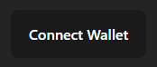
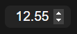

# Welcome To Agoric's UI Component Library

[`@agoric/react-components`](https://github.com/Agoric/ui-kit/tree/main/packages/react-components),
part of the [`Agoric/ui-kit`](https://github.com/Agoric/ui-kit) monorepo, provides React hooks and a
small set of pre-built components (a wallet-connect button, an amount input,
and a network-notice banner) that handle the repetitive parts of an Agoric
dapp frontend: watching vstorage, connecting to Keplr, and reading/writing
smart-wallet state. Utilization of these building blocks ensures best
practices in design and accessibility.

::: tip
The component set here has changed over time; some previously documented
components (a dedicated chain selector, node selector, and "Leap Elements")
are no longer part of the package. What's below reflects the current
`react-components` source.
:::

## Installation and Setup

See [`Agoric/ui-kit` README - Setup](https://github.com/Agoric/ui-kit#setup)
for setup instructions (these packages require [SES](https://github.com/endojs/endo/tree/master/packages/ses),
so lockdown must run before your app's other code), and
[`packages/react-components`](https://github.com/Agoric/ui-kit/tree/main/packages/react-components)
for the package overview.

```sh
yarn add @agoric/react-components
```

Most dapps also want [`@agoric/rpc`](https://github.com/Agoric/ui-kit/tree/main/packages/rpc)
(for `makeAgoricChainStorageWatcher`, to read vstorage) and
[`@agoric/web-components`](https://github.com/Agoric/ui-kit/tree/main/packages/web-components)
(for `makeAgoricWalletConnection`, to connect to Keplr and make/exit offers);
`react-components` wires both of these together behind the `useAgoric` hook
described below.

## UI Components List

These React UI components can be immediately used to streamline your Agoric Dapp UI:

- Connect Wallet
- Amount Input
- Notice Banner

## The `useAgoric` hook and `AgoricContext`

Most Agoric-related state (wallet address, connected chain, purses,
whether the smart wallet is provisioned, and helpers to make and exit offers)
is accessible through the `useAgoric()` hook, backed by `AgoricContext`. See
[`AgoricContext`](https://github.com/Agoric/ui-kit/blob/main/packages/react-components/src/lib/context/AgoricContext.ts)
for the full interface, which includes:

| Field                                                     | Type                            | Description                                           |
| --------------------------------------------------------- | ------------------------------- | ----------------------------------------------------- |
| `address`                                                 | `string \| undefined`           | The connected wallet's address                        |
| `purses`                                                  | `PurseJSONState[] \| undefined` | The connected wallet's purses                         |
| `isSmartWalletProvisioned`                                | `boolean \| undefined`          | Whether the address has a provisioned smart wallet    |
| `provisionSmartWallet`                                    | function                        | Provisions a smart wallet for the connected address   |
| `smartWalletProvisionFee` / `smartWalletProvisionFeeUnit` | `bigint` / `string`             | The current provisioning fee, and its denom           |
| `makeOffer` / `exitOffer`                                 | function                        | Make or exit a Zoe offer through the connected wallet |

There is no separate "Smart Wallet Provisioning" component; a dapp reads
`isSmartWalletProvisioned` and `smartWalletProvisionFee` from `useAgoric()`
and calls `provisionSmartWallet` from its own UI (for example, from a
[`NoticeBanner`](#notice-banner)).

## Connect Wallet



`ConnectWalletButton` shows "Connect Wallet" until a wallet is connected, then
shows the truncated connected address.

- [`ConnectWalletButton` source](https://github.com/Agoric/ui-kit/blob/main/packages/react-components/src/lib/components/ConnectWalletButton.tsx)

Customizable Parameters
| Parameter | Type | Description |
|----------|----------|----------|
| className | string \| undefined | CSS class name for the underlying `<button>` element |
| onClick | `(e: React.MouseEvent<HTMLButtonElement>) => void` \| undefined | Click handler; typically triggers your app's own connect flow before rendering this button |

## Amount Input



`AmountInput` handles converting between an input string and a denominated
`BigInt` value for a given asset.

- [`AmountInput` source and usage example](https://github.com/Agoric/ui-kit/tree/main/packages/react-components#amount-inputs)

Customizable Parameters
| Parameter | Type | Description |
|----------|----------|----------|
| value | bigint \| null | The current value of the input |
| decimalPlaces | number | The number of decimal places used for displaying the denominated value |
| className | string \| undefined | CSS class name for the underlying `<input>` element |
| onChange | `(value: bigint) => void` \| undefined | Callback for handling input changes |
| disabled | boolean \| undefined | Whether or not the input is disabled. Defaults to false. |

If you want a custom input component instead, the `useAmountInput` hook
exposes the same string/BigInt conversion logic on its own.

## Notice Banner

`NoticeBanner` is a dismissible, site-wide banner for network status
messages (for example, an upcoming chain upgrade), not a wallet-provisioning
dialog.

- [`NoticeBanner` source](https://github.com/Agoric/ui-kit/blob/main/packages/react-components/src/lib/components/NoticeBanner.tsx)

Customizable Parameters
| Parameter | Type | Description |
|----------|----------|----------|
| notices | `NetworkNotice[]` | The set of notices to consider; only currently-active ones are shown, joined together |
