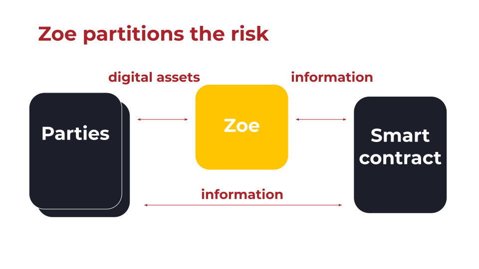

# Eventual Send with E()

In web browsers, a common pattern of remote communication is using the
[asynchronous fetch API with promises](https://developer.mozilla.org/en-US/docs/Learn_web_development/Extensions/Async_JS/Introducing):

<<< @/../snippets/test-distributed-programming.js#asyncFetch

In the Agoric platform, communicating with remote objects is similar,
using the `E()` wrapper. For example,
a [core-eval script](../getting-started/explainer-deploying-a-smart-contact) may want to use the
[Zoe Service API](/reference/zoe-api/zoe) to install a contract on the chain.
But the script cannot call `zoe.installBundleID(bundleId)` directly, because it does not have local
access to the `zoe` object. However, the script
is given a `zoe` _remote presence_ among its permitted powers. To call methods on the
actual Zoe object, the script can do:

<!-- excerpt: snippets/js-programming/eventual-send-install.js#installBundleId -->

```js
import { E } from '@endo/eventual-send';

const installationP = E(zoe)
  .installBundleID(bundleId)
  .then(installation => {
    console.log('installed', installation);
    return installation;
  })
  .catch(reason => {
    console.error('installation failed', reason);
    throw reason;
  });
```

## Eventual Send

One of the ways [Zoe partitions risk](https://www.youtube.com/watch?v=T6h6TMuVHKQ&t=368s) is by running in its own [vat](../../glossary/index#vat), separate from any smart contract that might
use too much compute time or heap space. The smart contracts also run in separate vats.



What happens when we call `E(zoe).install(bundle)` is an _eventual send_:

1.  A message consisting of the method name `install`
    with the `bundle` argument [marshaled](./far)
    to a flat string and queued for delivery to
    the vat that `zoe` comes from.
2.  `E(zoe).install(bundle)` returns a promise for the result.
3.  The `then` and `catch` methods queue callbacks for when the promise
    is resolved or rejected.
    Execution continues until the stack is empty and thus this
    turn through the event loop completes.
4.  _Eventually_ `zoe` responds, which results in a new message
    in this vat's message queue and a new turn through the event loop.
    The message is de-serialized and the results are passed to the relevant callback.

This way, you can communicate with objects in separate vats
as easily as objects in the same vat with one wrinkle: the communication
must be _asynchronous_.

The `E()` wrapper works with:

- Remote presences (local proxies for objects in remote vats).
- Local objects (in the same vat).
- Promises for remote presences or local objects.

In all cases, `E(x).method(...args)` returns a promise.

::: tip Promise Pipelining
Since `E()` accepts promises, we can compose eventual sends:
`E(E(object1).method1(...args1)).method2(...args2)`. This way
we can take advantage of _promise pipelining_ so that a single
round trip suffices for both method calls.
:::

## E.when, E.get, and E.sendOnly

`E(x).method(...args)` is the common case, but `E` exports a few more entry
points for other shapes of eventual interaction:

- **`E.when(x, onFulfilled, onRejected)`** is equivalent to
  `Promise.resolve(x).then(onFulfilled, onRejected)`, except that `x` may be
  a presence, a promise, or a Vow (see [Vows](#vows-and-durable-eventual-send)
  below), and the resolution can involve a remote round trip. Prefer
  `E.when(x)` (or `await E.when(x)`) over `x.then(...)` or bare `await x`
  when `x` might be a presence, since a plain promise method assumes `x` is
  already a local promise.

  <!-- excerpt: snippets/js-programming/test-eventual-send.js#eWhen -->

  ```js
  import { E } from '@endo/far';

  const installationHandle = await E.when(E(zoe).install(bundle));
  ```

- **`E.get(x).property`** returns a promise for a property of whatever `x`
  settles to, without waiting for a method call. Reach for it when a remote
  call answers with a record, such as an issuer kit or a contract's terms: a
  `Far()` remotable's own properties are all methods, so `E.get` is for the
  record on the other side of a promise rather than for a presence itself.

  <!-- excerpt: snippets/js-programming/test-eventual-send.js#eGet -->

  ```js
  const brand = await E.get(issuerKitP).brand;
  ```

- **`E.sendOnly(x).method(...args)`** sends a message the same way `E(x)`
  does, but discards the result and returns `undefined` immediately. Use it
  for fire-and-forget notifications where you don't need (and don't want to
  pay for tracking) a result promise.

  <!-- excerpt: snippets/js-programming/test-eventual-send.js#eSendOnly -->

  ```js
  E.sendOnly(logger).record(event);
  ```

::: tip Prefer E.when(x) over x.then(...)
Since a Presence is inert (it's a marshalled reference, not a native
`Promise`), only `HandledPromise`-aware operators like `E`, `E.when`, and
`E.get` know how to route messages, get properties, and follow redirection
correctly across a Vow or a disconnected/reconnected Presence. A bare
`.then()` works today only because most values you await eventually resolve
to native promises; it silently stops working the moment that value is
replaced by a [Vow](#vows-and-durable-eventual-send).
:::

::: tip Troubleshooting remote calls
The `E()` function creates a
forwarder that doesn't know what methods the remote object has.
If you misspell or incorrectly capitalize the method name,
the local environment can't tell you've done so. You'll only find out at runtime when the
remote object complains that it doesn't know that method.

If an ordinary synchronous call (`obj.method()`) fails because the method doesn't exist, the `obj` may be remote, in which case `E(obj).method()` might work.
:::

::: tip Testing with Deep Stacks

To get stack traces that cross vats:

```
TRACK_TURNS=enabled DEBUG=track-turns yarn test test/contract.test.js
```

See:

- [\$DEBUG](https://github.com/Agoric/agoric-sdk/blob/master/docs/env.md#debug)
- [\$TRACK_TURNS](https://github.com/Agoric/agoric-sdk/blob/master/docs/env.md#track_turns)
- [\$LOCKDOWN_OPTIONS for better diagnositcs](https://github.com/Agoric/agoric-sdk/wiki/Developing-with-better-error-diagnostics)

:::

## Vows and Durable Eventual-Send

Everything above works whether or not the vats involved are ever upgraded.
But a native JavaScript `Promise` cannot be stored in a durable store: if a
vat is upgraded while a client holds a promise for one of that vat's results,
the promise is lost, and the client hangs forever waiting for a resolution
that will never come.

A **Vow** (from [`@agoric/vow`](https://github.com/Agoric/agoric-sdk/tree/master/packages/vow))
is a Passable, durably storable stand-in for a promise. Any code that expects
to survive its own vat's upgrade, or that hands out a result to a client that
might survive the result's originating vat's upgrade, should traffic in Vows
rather than raw promises for anything long-lived.

`prepareVowTools(zone)` returns the tools bound to a particular
[zone](./zones)'s durable storage:

<!-- excerpt: snippets/js-programming/test-eventual-send.js#prepareVowTools -->

```js
import { prepareVowTools } from '@agoric/vow';
import { makeDurableZone } from '@agoric/zone/durable.js';

// Once, at the start of a vat incarnation:
const zone = makeDurableZone(baggage);
const { watch, when, makeVowKit } = prepareVowTools(zone);
```

- **`when(vowOrPromise)`** returns a promise for the vow's eventual
  fulfillment. It retries automatically across a disconnection caused by an
  upgrade of some _other_ vat in the chain, but like any plain promise, it
  cannot itself survive an upgrade of the vat that's `await`ing it.
- **`watch(vowOrPromise, watcher, context)`** subscribes a durable `watcher`
  object (with `onFulfilled`/`onRejected` methods) to a Vow. Because the
  watcher and its `context` are durable Exo state rather than a closure, the
  subscription survives an upgrade of both the vat producing the Vow _and_
  the vat consuming it: on resume, the new incarnation's `watch` call finds
  the still-pending Vow in baggage and picks up where it left off. This is
  the durable-replay-safe way to react to a long-running result.
- **`makeVowKit()`** makes a `{ vow, resolver }` pair analogous to a
  promise's executor: hand the `vow` to a caller, keep the `resolver` to
  settle it later, potentially in a different vat incarnation than the one
  that created it.
- For code that isn't itself durable but calls into vats that use Vows, use
  the plain `E` from `@endo/far`: `E` already treats a settled Vow the way it
  treats a promise, so `await E(x).method()` works whether `x`'s vat answers
  with a promise or a Vow.
- **`watchPromise(promise, watcher, ...watcherArgs)`** (from
  [`@agoric/base-zone`](https://github.com/Agoric/agoric-sdk/blob/master/packages/base-zone/src/watch-promise.js))
  is the analogous durable subscription for an ordinary (non-Vow) promise:
  use it instead of `promise.then(...)` whenever the watcher needs to survive
  an upgrade of the watching vat, even though the promise itself is native
  and non-durable.

::: tip Vows vs. plain E()
For request/response calls that complete within a single turn or two, plain
`E()` is simpler and remains the right default. Reach for Vows specifically
when a result might still be outstanding across a vat upgrade: long-running
orchestration flows, cross-chain calls, or any handle you hand to a client
you expect to hold onto for a while. See
[async-flow](https://github.com/Agoric/agoric-sdk/tree/master/packages/async-flow)
for the complementary durable-replay mechanism for whole `async function`
bodies (not just individual awaited values), which is built on Vows.
:::

## E() and Marshal: A Closer Look

::: tip Watch: Office Hours Discussion of Marshal

- [Office Hours: ... marshalling w/board ids, ... \#8069](https://github.com/Agoric/agoric-sdk/discussions/8069) July 2023

:::

If you just want to use the SDK to write smart contracts, **feel
free to skip this section**. But in case you're working
on something that requires more detailed understanding,
let's take a look at how `E(x).method(...args)` is marshalled.

In [@endo/marshal](https://github.com/endojs/endo/tree/master/packages/marshal#readme) docs, we see:

> The `marshal` module helps with conversion of "capability-bearing data", in
> which some portion of the structured input represents "pass-by-proxy" or
> "pass-by-presence" objects that should be serialized into values referencing
> special "slot identifiers". The `toCapData()` function returns a "CapData"
> structure: an object with a `body` containing a serialization of the input data,
> and a `slots` array holding the slot identifiers. `fromCapData()` takes this
> CapData structure and returns the object graph. There is no generic way to
> convert between pass-by-presence objects and slot identifiers, so the marshaller
> is parameterized with a pair of functions to create the slot identifiers and turn
> them back into proxies/presences.

For example, we can marshal a remotable counter using the slot identifier `c1`:

<<< @/../snippets/test-marshal.js#marshal-remotable

Each end of a connection between vats typically keeps
a table to translate slots to capabilities and back:

<<< @/../snippets/test-marshal.js#marshal-table

Each call to `E(rx)` makes a proxy for the reciver `rx`;
each `E(rx).p` property reference invokes the `get` proxy trap.
From the `get` trap, `E` returns a function that queues
`rx`, `p`, and its arguments (in marshalled form) and returns a promise:

<<< @/../snippets/test-marshal.js#marshal-messages-e

Now we can see the result in some detail. Note the way the promise from
`E(zoe).install()` is passed to `E(zoe).startInstance()`.

<<< @/../snippets/test-marshal.js#marshal-messages

::: tip Watch: How Agoric Solves Reentrancy Hazards (November 2020)
for more on eventual send and remote communication

<ClientOnly>
<iframe width="560" height="315" src="https://www.youtube.com/embed/38oTyVv_D9I" title="YouTube video player" frameborder="0" allow="accelerometer; autoplay; clipboard-write; encrypted-media; gyroscope; picture-in-picture" allowfullscreen></iframe>
</ClientOnly>
:::
