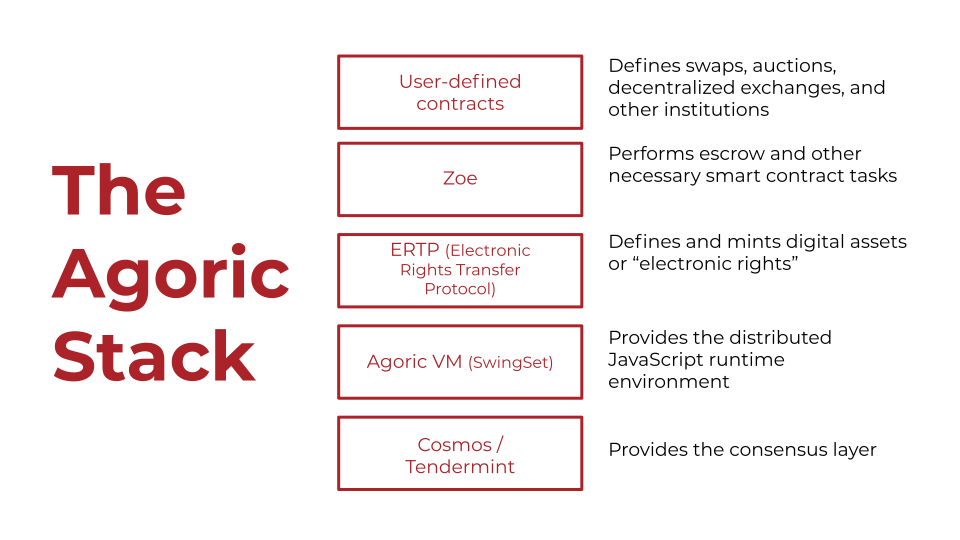

# The Agoric Platform

This document focuses on the layers beneath Zoe and ERTP, what we call
the Agoric Platform. This includes "SwingSet", which can be thought of
as our VM providing a distributed Javascript environment, as well as
the Cosmos SDK and IBC.

## SwingSet

On a single blockchain, or even a single machine with multiple users,
it's very important to ensure that one user cannot prevent another
user's code from executing and that the way in which code is
interleaved doesn't open up hazards such as reentrancy. SwingSet
solves that problem by dividing up the execution environment into
_vats_. A [vat](../js-programming/#vats-the-unit-of-synchrony) is a _unit
of synchrony_. This means that within a JavaScript vat, objects and
functions can communicate with one another synchronously. Between
vats, objects and functions communicate asynchronously, by design.

A physical machine can run one or several vats. A blockchain can run
one or several communicating vats.

The internal state of a vat can be stored in a persistent memory so
that the vat can be turned off and later turned back on (on the same
or a different physical machine) by loading the stored state.

A SwingSet instance also handles communication between the vats it
provides and the outside world. On a blockchain, this means writing to
a part of the state that is intended to serve as an outbox. On a
non-blockchain machine, this might mean sending a message to a remote
machine.

SwingSet provides [orthogonal persistence](<https://en.wikipedia.org/wiki/Persistence_(computer_science)#Orthogonal_or_transparent_persistence>).

SwingSet also supports **vat upgrade**: a running vat can be pointed at a new
code bundle without losing its durable state, so contracts and platform
services can be fixed or extended in place instead of being redeployed from
scratch. See the [Orchestration guide](../orchestration/) for how the
platform builds on this to let a contract hold and move assets across
chains from a single durable, upgradable vat.

## Cosmos SDK

The Agoric chain runs a single SwingSet instance with multiple vats on top
of Cosmos SDK. SwingSet and most of our code is written in JavaScript, so we
have a process that starts up the JavaScript environment, starts a SwingSet
instance, and then connects through Go to the Cosmos SDK modules, the
consensus engine (CometBFT), and back again.

## Dynamic IBC

IBC is the protocol for [Inter-Blockchain
Communication](https://cosmos.network/technology). IBC enables messages to
be sent from one blockchain to another with the use of intermediary
relayers.

Dynamic IBC (dIBC) solves the problem of rolling out a new protocol on top of
IBC without needing a platform upgrade or chain governance vote: a smart
contract or VM platform can deploy new contracts that support new protocols,
all on an existing chain. This is no longer just a proposal; it's the
mechanism the [Orchestration API](../orchestration/) uses today to let a
contract open and manage ICA (Interchain Accounts) and IBC connections to
other chains, and it's what the [Fast USDC](https://github.com/Agoric/agoric-sdk/tree/master/packages/fast-usdc#readme)
contract uses to move funds between Noble and Agoric.

For background, see [a recent article on
dIBC](https://medium.com/agoric/the-road-to-dynamic-ibc-4a43bc964bca).

## CometBFT

CometBFT is the consensus engine, defining how blocks are agreed upon
and created. Effectively, CometBFT is the lowest level layer that
defines the blockchain itself. (CometBFT is the actively maintained
continuation of the project formerly known as Tendermint Core.)
